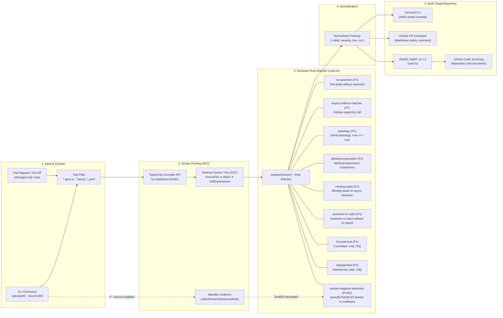

# Vigía

**A GitHub Action that flags tests which pass without verifying anything.**

A green suite is not the same as a tested codebase. Vigía reads the test files touched by a pull request, finds the ones that can never fail, and comments on the exact line — before the branch merges and the false confidence becomes permanent.

[](https://github.com/eduardo-mr1/vigia/actions)
[](https://github.com/marketplace/actions/vigia-assertion-guard)


---

## The problem

Every team has this test:

```js
it('creates the order', async () => {
  const order = await createOrder(payload)
  // ...and nothing else
})
```

It runs. It passes. It goes green on every commit for two years. It verifies nothing.

Coverage tools won't catch it — the line *was* executed. Code review won't catch it either, because reviewers read the diff for what it says, not for what it forgot to say. So the suite grows, the number goes up, and the confidence it buys is partly fictional.

Vigía is the check for that specific blind spot.

---

## Demo


Real output from `node dist/cli.js ejemplo` against the fixture in this repo — nothing staged.

---

## What it detects

Ten checks, all built on the same idea: a test that can't fail is worse than no test, because it occupies the place of one that would.

| Rule | Severity | Example |
|---|---|---|
| **No assertion** | P1 | A test body that never calls an assertion |
| **`expect()` without a matcher** | P1 | `expect(result)` with no `.toBe(...)` chained after it |
| **Tautology** | P1 | `expect(true).toBe(true)`, comparing a literal to itself |
| **Identical expression** | P1 | `expect(user.id).toBe(user.id)`, comparing an expression to itself |
| **Redundant boolean assertion** | P2 | `expect(a === b).toBe(true)` — hides diffs; should be `expect(a).toBe(b)` |
| **Missing `await`** | P1 | `expect(promise).rejects.toThrow()` with no `await` — the test ends before the promise settles |
| **Assertion in `catch`** | P1 | `try { await op(); } catch (e) { expect(e)... }` without a failure guard in `try` — passes silently if `op()` never throws |
| **Focused test (`.only`)** | P1 | `it.only(...)` silently skips the rest of the suite in CI |
| **Skipped test** | P3 | `it.skip` / `xit` left behind past its reason for existing |
| **Orphan negative assertion** | P1 / P2 | `queryByTestId('x')` expected to be null/absent, but `"x"` never appears anywhere in the source — the assertion can't fail because the thing it denies doesn't exist |

The first nine run on any Jest or Vitest test file, with native support for Cypress (`.should()`, `.and()`), Chai (`assert.*`) and Playwright's async locator matchers (`toBeVisible`, `toHaveText`, etc. — every Playwright assertion is a promise, so a missing `await` is invisible on the page but silent in the suite). The tenth needs `--src` pointed at your source root, and also reads Maestro YAML flows for the same defect in E2E specs.

---

## Architecture & AST Pipeline

> 📖 **Deep-Dive Specification:** See [docs/arquitectura/README.md](../docs/arquitectura/README.md) and [docs/arquitectura/vigia-ast-pipeline.md](../docs/arquitectura/vigia-ast-pipeline.md) for full static analysis and SARIF export details.



---

## Usage

Add one step to your workflow:

```yaml
# .github/workflows/vigia.yml
name: Vigía
on: pull_request

jobs:
  check:
    runs-on: ubuntu-latest
    permissions:
      contents: read
      pull-requests: write       # required to post the comment
      security-events: write     # required for GitHub Code Scanning alerts
    steps:
      - uses: actions/checkout@v4
        with:
          fetch-depth: 0
      - uses: eduardo-mr1/vigia@v1
        with:
          source: 'src'
```

By default it analyzes test files changed in the PR, posts a sticky comment on the PR, and exports findings to **GitHub Code Scanning** via OASIS SARIF v2.1.0.

> 📖 **Guía completa de integración CI/CD:** Consulta [docs/action.md](docs/action.md) para detalles avanzados, matrices de monorepositorios y flujos programados.

### Inputs

| Input | Default | Description |
|---|---|---|
| `path` | `.` | Directory to analyze when not limited to the PR's changed files |
| `changed-only` | `true` | Analyze only the test files touched by the PR |
| `source` | `""` | Path to your source root. Set this to enable orphan-negative-assertion detection |
| `fail-on-p1` | `true` | Fail the job when a P1 finding is present |
| `comment` | `true` | Post the report as a sticky PR comment |
| `sarif` | `true` | Generate OASIS SARIF v2.1.0 report for GitHub Code Scanning |
| `sarif-file` | `vigia-results.sarif` | Output path for the SARIF report |
| `upload-sarif` | `true` | Upload SARIF report automatically to GitHub Code Scanning |
| `category` | `vigia` | Category name for Code Scanning analysis matrix |

### Outputs

| Output | Description |
|---|---|
| `findings` | Total number of detected findings |
| `p1` | Number of P1 findings |
| `sarif-file` | Path to the generated SARIF report |

### Jest Example

```yaml
name: Test Suite (Jest)
on: [push, pull_request]

jobs:
  test:
    runs-on: ubuntu-latest
    permissions:
      contents: read
      pull-requests: write
      security-events: write
    steps:
      - uses: actions/checkout@v4
        with:
          fetch-depth: 0
      - uses: actions/setup-node@v4
        with:
          node-version: 20
      - run: npm ci
      - run: npm test -- --coverage
      - uses: eduardo-mr1/vigia@v1
        with:
          source: 'src'
          fail-on-p1: 'true'
```

### Vitest Example

```yaml
name: Test Suite (Vitest)
on: [push, pull_request]

jobs:
  test:
    runs-on: ubuntu-latest
    permissions:
      contents: read
      pull-requests: write
      security-events: write
    steps:
      - uses: actions/checkout@v4
        with:
          fetch-depth: 0
      - uses: actions/setup-node@v4
        with:
          node-version: 20
      - run: npm ci
      - run: npx vitest run --coverage
      - uses: eduardo-mr1/vigia@v1
        with:
          path: 'src'
          source: 'src'
          category: 'vitest-suite'
```

You can also run it as a CLI, outside of CI:

```bash
npx vigia src/**/*.test.ts --src src --format markdown
npx vigia src --format sarif -o results.sarif

---

## How it works

Vigía parses every test file with the TypeScript compiler API (`ts.createSourceFile`) instead of matching text — an `expect` inside a comment or a string literal isn't an assertion, and only the syntax tree can tell the difference. For every `it`/`test` block (including chained forms like `it.skip.each`), it walks the body looking for a call that can actually fail: `expect(...)`, `.should()`/`.and()` (Cypress), or `assert.*` (Chai).

The orphan-negative-assertion check works differently: it scans your **source** for every `testID` / `data-testid` literal and template prefix (`` testID={`gasto-${id}`} `` → prefix `gasto-`), then cross-references every negative assertion in your **tests** (`expect(queryByTestId('x')).toBeNull()`, or `assertNotVisible` in a Maestro flow) against that set. An identifier the source can never produce means the assertion passes by definition — it isn't testing absence, it's testing a typo.

Written in TypeScript. Vigía never executes your tests — it only reads them, so it stays fast even on large suites.

---

## Vigía tests itself

The tool that polices assertions isn't exempt from them: **129 tests across 4 suites**, every rule covered by both a positive and a negative fixture, and a dedicated `self-check` CI job that runs Vigía against its own `src/` on every push.

```bash
npm test              # 129 tests
node dist/cli.js src  # Vigía, on Vigía
```

`ejemplo/carrito.test.ts` is a live fixture with all six static-analysis defects in one small file — a shopping-cart test suite that's fully green in Jest and verifies nothing:

```
$ node dist/cli.js ejemplo

ejemplo/carrito.test.ts:8:3   P1  no-assertion            Test "calculates the total" contains no assertion.
ejemplo/carrito.test.ts:14:5  P1  expect-without-matcher  expect() with no matcher chained.
ejemplo/carrito.test.ts:18:5  P1  tautology               expect(true) compared against itself.
ejemplo/carrito.test.ts:21:3  P3  skipped-test            "validates an expired coupon" is skipped.
ejemplo/carrito.test.ts:25:3  P1  focused-test            "adds tax" uses .only: the rest of the suite doesn't run.
ejemplo/carrito.test.ts:31:5  P1  missing-await           expect(...).rejects with no await: the test ends before checking anything.

6 finding(s): 5 P1, 0 P2, 1 P3
```

---

## Limitations

Worth stating plainly, because a linter you can't trust is worse than none:

- **It reasons about structure, not meaning.** A test with one weak assertion passes Vigía and still proves little. Vigía raises the floor; it doesn't measure quality.
- **Custom assertion helpers** that wrap `expect` internally aren't recognized unless they match a known pattern — they read as absent.
- **Only JavaScript and TypeScript**, plus Maestro YAML flows for the orphan-assertion check.
- **Not yet run against a real production PR stream.** It's fully built and fully tested against its own fixtures; the next milestone is piloting it on a live repository.

---

## Why I built it

I lead QA for a mobile product where a passing suite is the gate before release. The case that triggered this: an E2E flow asserted that an element was *not* visible — using an identifier the app never actually generates. The assertion passed on every run, for weeks, without checking anything. A test that verifies nothing doesn't just fail to catch a bug; it actively hides that the case was never covered, which is worse than having no test at all. Reviewers miss this pattern consistently, and no existing tool was looking for it. So I wrote the one that does.

---

## License

MIT — see [LICENSE](LICENSE).
